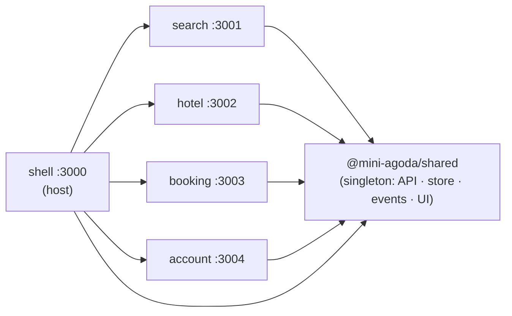

# 🏨 Mini Agoda

A mini hotel-booking website in the style of Agoda, built with a **micro
frontend architecture**: **React 19 + Vite 8 + Module Federation 2**, in an npm
workspaces monorepo. All data is mocked, so no backend is needed.



## Quick start

```bash
npm install
npm run dev
```

Open **http://localhost:3000**.

| Demo login | `demo@miniagoda.com` / `password123` |
| --- | --- |
| Test card | `4242 4242 4242 4242`, any future expiry, any CVV |
| Promo codes | `AGODA10`, `MINI20`, `WELCOME5` |

Press **🧩** (bottom-left) or **Ctrl+Shift+M** to open the micro frontend
inspector and outline each MFE on the page.

## Features

- **Search:** destination autocomplete (cities and hotels), dates, guests and rooms, recent searches, popular destinations, top deals
- **Results:** filters (budget, stars, review score, property type, facilities, free cancellation), 6 sort orders, pagination, all synced to the URL
- **Hotel page:** photo gallery and lightbox, overview, rooms and rates with capacity and availability checks, facilities, reviews (score breakdown, traveller filter, paging), location, policies, similar hotels
- **Checkout:** guest details with validation, card (Luhn check) or pay-at-hotel, promo codes, tax breakdown, price-hold timer, confirmation page
- **Account:** sign in and sign up, profile, my trips (upcoming, past and cancelled, with free cancellation), wishlist
- **Global:** multi-currency (USD, INR, EUR, THB, SGD, JPY), toasts, error isolation per micro frontend, responsive layout, accessible forms and dialogs

## Repository

```text
apps/
  shell/      host: layout, routing, toasts, currency, MFE inspector
  search/     remote: HomePage, SearchPage
  hotel/      remote: HotelPage
  booking/    remote: BookingApp (checkout, confirmation)
  account/    remote: AccountApp (auth, trips, wishlist, profile), UserMenu
packages/
  shared/       types, mock API, stores, event bus, utils, UI kit, design tokens
  vite-config/  one config factory + remote registry for all apps
docs/         system design, data flow, architecture, contracts, ADRs
```

## Documentation

Start with **[docs/DATA_FLOW.md](docs/DATA_FLOW.md)**, which explains how
everything fits together in plain English. Then see the [docs index](docs/README.md):

- [System design](docs/SYSTEM_DESIGN.md): requirements, high-level design, trade-offs, path to production
- [Architecture](docs/ARCHITECTURE.md): code layout, how Module Federation is wired, rules
- [Micro frontends](docs/MICRO_FRONTENDS.md): ownership, exposes, URL and event contracts
- [Communication](docs/COMMUNICATION.md) · [Data model and API](docs/DATA_MODEL.md) · [Development](docs/DEVELOPMENT.md) · [Deployment](docs/DEPLOYMENT.md)
- [Architecture decision records](docs/README.md#architecture-decision-records)

## Scripts

| Command | Description |
| --- | --- |
| `npm run dev` | Run all 5 apps with HMR |
| `npm run dev -w @mini-agoda/hotel` | Run one micro frontend standalone |
| `npm run build` | Production build of every app |
| `npm start` | Build and preview the production bundles |
| `npm run typecheck` | Type-check every workspace |
# mini-agoda
