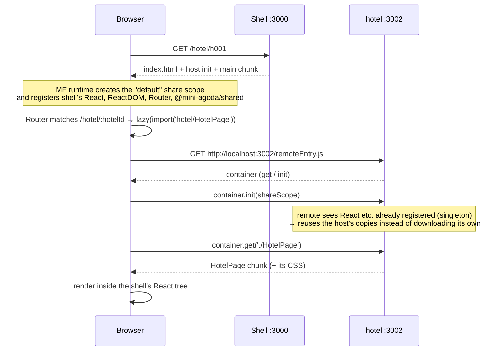
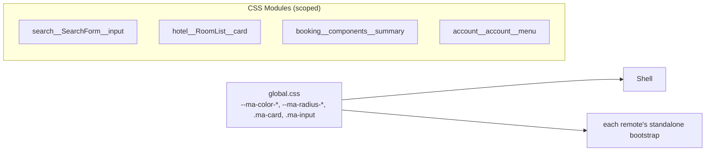

# Architecture

How the code is organised, how Module Federation stitches the apps together,
and the rules every micro frontend follows.

- Big-picture design & requirements → [SYSTEM_DESIGN.md](./SYSTEM_DESIGN.md)
- Data flow in simple terms → [DATA_FLOW.md](./DATA_FLOW.md)

---

## 1. Tech stack

| Layer            | Choice                                               |
| ---------------- | ---------------------------------------------------- |
| UI               | React 19, TypeScript 5                               |
| Routing          | React Router 7 (declarative mode, one shared instance) |
| Build / dev      | Vite 8 (Rolldown)                                    |
| Micro frontends  | Module Federation 2 via `@module-federation/vite`    |
| Styling          | CSS Modules (scoped per MFE) + CSS custom properties |
| State            | Tiny store on `useSyncExternalStore` + DOM event bus |
| Data             | Mock async API + `localStorage`                      |
| Monorepo         | npm workspaces                                       |

---

## 2. Repository layout

```text
Mini-Agoda/
├── apps/
│   ├── shell/                 # Host - port 3000
│   │   ├── index.html
│   │   ├── vite.config.js     # remotes: search, hotel, booking, account
│   │   └── src/
│   │       ├── index.ts       # async boundary → import('./bootstrap')
│   │       ├── bootstrap.tsx  # createRoot + <BrowserRouter>
│   │       ├── App.tsx        # top-level <Routes>
│   │       ├── remotes.d.ts   # TS types for every exposed module
│   │       ├── federation/    # createRemote, RemoteBoundary, registry
│   │       └── components/    # Header, Footer, Toaster, MfeInspector, NotFound
│   ├── search/                # Remote - port 3001 (exposes HomePage, SearchPage)
│   ├── hotel/                 # Remote - port 3002 (exposes HotelPage)
│   ├── booking/               # Remote - port 3003 (exposes BookingApp)
│   └── account/               # Remote - port 3004 (exposes AccountApp, UserMenu)
├── packages/
│   ├── shared/                # @mini-agoda/shared - the cross-team contract
│   │   └── src/
│   │       ├── types.ts       # domain model
│   │       ├── api/           # mock backend (async, latency, localStorage)
│   │       ├── data/          # seeded mock data generators
│   │       ├── store.ts       # authStore, currencyStore, wishlistStore
│   │       ├── events.ts      # typed event bus + toast helpers
│   │       ├── hooks.ts       # useAsync, useDocumentTitle, …
│   │       ├── utils/         # currency, dates, pricing, URL params, validation
│   │       ├── ui/            # Button, Price, ScoreBadge, Modal, SmartImage, …
│   │       └── styles/global.css  # design tokens + base styles
│   └── vite-config/           # createConfig() + remotes registry
└── docs/                      # you are here
```

Every remote has the **same internal shape**:

```text
apps/<name>/
├── index.html          # used only when running standalone
├── vite.config.js      # createConfig({ name, exposes })
├── package.json
└── src/
    ├── index.ts        # import('./bootstrap')
    ├── bootstrap.tsx   # standalone harness (own router + StandaloneLayout)
    ├── pages/ | *App.tsx   # what gets exposed
    └── components/
```

---

## 3. How Module Federation works here



### 3.1 The shared config factory

All five apps call one function, [`packages/vite-config/index.js`](../packages/vite-config/index.js):

```js
// apps/hotel/vite.config.js
export default createConfig({
  dirname: import.meta.dirname,
  name: 'hotel',
  exposes: { './HotelPage': './src/pages/HotelPage.tsx' },
});
```

It configures, identically for everyone:

- `federation({ name, filename: 'remoteEntry.js', exposes, remotes, shared })`
- **Shared singletons:** `react`, `react-dom`, `react-router-dom`, `@mini-agoda/shared`
- CSS Modules naming: `<mfe>__<file>__<class>` in dev, `<mfe>_<hash>` in prod
- Fixed port per app, `server.origin` (so remote assets resolve to the remote's own host), CORS
- Absolute `base` for remotes in production builds
- `build.target: 'esnext'` (federation needs top-level `await`)

### 3.2 Remote registry

[`packages/vite-config/remotes.js`](../packages/vite-config/remotes.js) is the
single source of truth for names, ports and URLs:

| Name    | Port | Env override  |
| ------- | ---- | ------------- |
| shell   | 3000 | `SHELL_URL`   |
| search  | 3001 | `SEARCH_URL`  |
| hotel   | 3002 | `HOTEL_URL`   |
| booking | 3003 | `BOOKING_URL` |
| account | 3004 | `ACCOUNT_URL` |

### 3.3 Why `import('./bootstrap')`?

`src/index.ts` only does `import('./bootstrap')`. That **async boundary** gives
the federation runtime a tick to negotiate shared singletons before React is
imported. Without it you risk two Reacts on the page ("Invalid hook call").

---

## 4. Loading remotes safely (`createRemote`)

```tsx
// apps/shell/src/federation/remotes.tsx
export const HotelPage = createRemote('hotel', 'HotelPage', () => import('hotel/HotelPage'));
export const UserMenu = createRemote('account', 'UserMenu', () => import('account/UserMenu'), {
  loading: <Skeleton width={96} height={36} />,
  errorFallback: () => <Link to="/account/login">Sign in</Link>,
});
```

`createRemote` wraps every federated module in:

1. `React.lazy` - created **once per module**, so navigating back doesn't re-suspend.
2. `<Suspense>` - spinner (or custom placeholder) while the chunk downloads.
3. `<RemoteBoundary>` - catches load & render errors and offers **Retry**. Retry creates a fresh `lazy()` so the import is attempted again.
4. `<div data-mfe="hotel">` - lets the **MFE Inspector** outline each remote.
5. Status reporting to `registry.ts` (idle → loading → loaded/failed) for the inspector.

---

## 5. Page vs. fragment remotes

| Kind         | Example               | Mounted by                      | Owns routes?           |
| ------------ | --------------------- | ------------------------------- | ---------------------- |
| **Page**     | `search/SearchPage`, `hotel/HotelPage` | a single shell route | No - one URL |
| **Sub-app**  | `booking/BookingApp`, `account/AccountApp` | shell route with `/*` | **Yes** - nested `<Routes>` |
| **Fragment** | `account/UserMenu`    | inside the shell header         | No - a widget          |

Sub-apps use **relative** route paths (`path="checkout"`), so the shell can
re-mount them under any prefix.

---

## 6. Rules of the road

1. **No cross-MFE imports.** `apps/hotel` must never import from `apps/search`.
   Share via `@mini-agoda/shared` or communicate via URL/store/events.
2. **Import the shared package from its root only** (`@mini-agoda/shared`),
   never deep paths. The one exception is `@mini-agoda/shared/styles.css`.
3. **Style with CSS Modules.** Only consume global tokens (`var(--ma-*)`) and
   the few `ma-*` utility classes; never write global selectors in an MFE.
4. **The URL is a public API.** Adding params is fine; renaming/removing one is
   a breaking change (see [MICRO_FRONTENDS.md](./MICRO_FRONTENDS.md#url-contracts)).
5. **Every remote must run standalone** (`npm run dev -w @mini-agoda/<name>`).
6. **Exposed modules default-export a component with no required props.**
   Inputs come from the URL or shared stores.
7. **Never trust client-provided prices.** Always derive from the API.

---

## 7. Styling architecture



- Tokens are loaded **once** by the shell.
- Each MFE's class names are prefixed with its name, so `.card` in hotel can
  never clash with `.card` in search.
- Remote CSS is bundled with the exposed module (`bundleAllCSS`) and injected
  when the module loads.

---

## 8. Developer tooling

| Tool                     | Where                                   | What it does                                  |
| ------------------------ | --------------------------------------- | --------------------------------------------- |
| **MFE Inspector** 🧩      | bottom-left of the shell, Ctrl+Shift+M  | Lists remotes, owners & status; outlines MFEs on the page. |
| **Standalone mode**      | `http://localhost:300X` for each remote | Develop one MFE in isolation with a dark dev bar. |
| **`npm run typecheck`**  | root                                    | Type-checks every workspace.                  |
