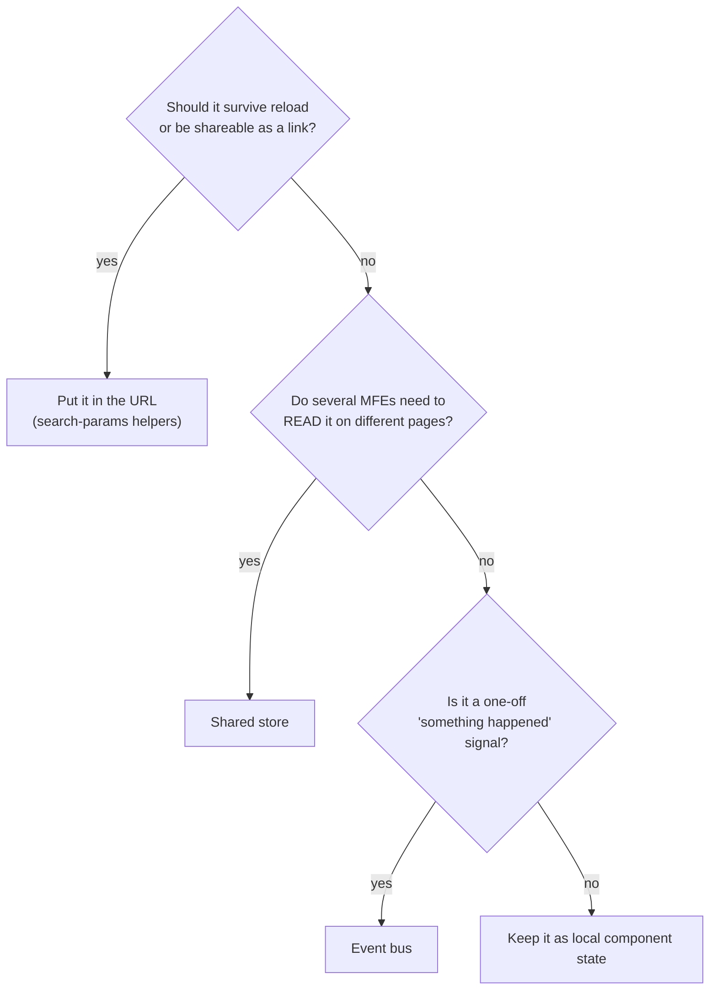

# Cross-MFE Communication - How-to

Conceptual overview: [DATA_FLOW.md §3](./DATA_FLOW.md#3-three-ways-data-moves-and-when-to-use-each).
This page has the code recipes.

## Decision tree



## 1. URL

```ts
import { hotelUrl, checkoutUrl, parseCriteria } from '@mini-agoda/shared';

navigate(hotelUrl('h001', criteria));                 // search → hotel
navigate(checkoutUrl(hotel.id, room.id, stay));       // hotel → booking

const [params] = useSearchParams();
const criteria = parseCriteria(params);               // always validated + defaulted
```

## 2. Shared store

```ts
import { useAuth, useCurrency, useWishlist, setCurrency, setCurrentUser, toggleWishlist } from '@mini-agoda/shared';

const { user, isAuthenticated } = useAuth();          // re-renders on login/logout anywhere
const currency = useCurrency();
const { hotelIds, isSaved } = useWishlist();

setCurrency('INR');                                   // also emits currency:changed
setCurrentUser(user);                                 // also emits auth:changed
toggleWishlist('h001');                               // also emits wishlist:changed
```

How it works: [`store.ts`](../packages/shared/src/store.ts) is a ~30-line
`createStore()` built on React's `useSyncExternalStore`. Each store:

- persists to `localStorage` (`mini-agoda:<key>`),
- re-reads on the browser `storage` event, so **other tabs stay in sync**,
- is a **single instance** because `@mini-agoda/shared` is a federation singleton.

Need a new global store? Add it to `store.ts` with a `useX()` hook and a
`setX()` writer, and document the owner in [DATA_FLOW.md §5](./DATA_FLOW.md#5-who-owns-which-data).

## 3. Event bus

```ts
import { eventBus, toast } from '@mini-agoda/shared';

// publish
eventBus.emit('booking:created', { booking });
toast.success('Saved!');                              // shorthand for ui:toast

// subscribe (always clean up)
useEffect(() => eventBus.on('booking:created', ({ booking }) => reload()), [reload]);
```

Events are `CustomEvent`s on `window` with the prefix `mini-agoda:`, so they work
even across separately bundled code. To add an event, extend `MfeEventMap` in
[`events.ts`](../packages/shared/src/events.ts). TypeScript then enforces the
payload everywhere.

## Anti-patterns

| ❌ Don't                                              | ✅ Do instead                              |
| ---------------------------------------------------- | ----------------------------------------- |
| `import { HotelCard } from '../../search/src/...'`   | Move it to `@mini-agoda/shared/ui` or duplicate |
| Pass the price from hotel → booking in the URL       | Pass `roomId`; fetch the price from the API |
| Store search results in a global store               | Re-fetch from URL params (cheap, always fresh) |
| Use events to *request* data ("give me the user")    | Read the store                             |
| Global CSS selectors inside an MFE                   | CSS Modules + design tokens                |
