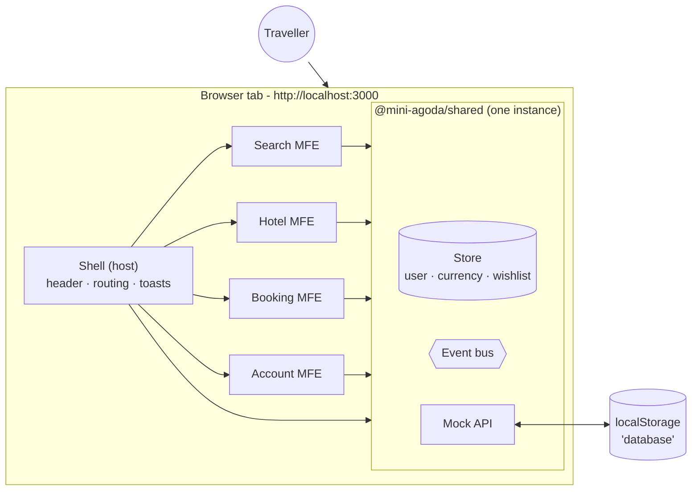
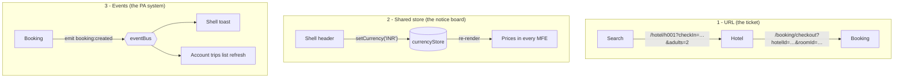
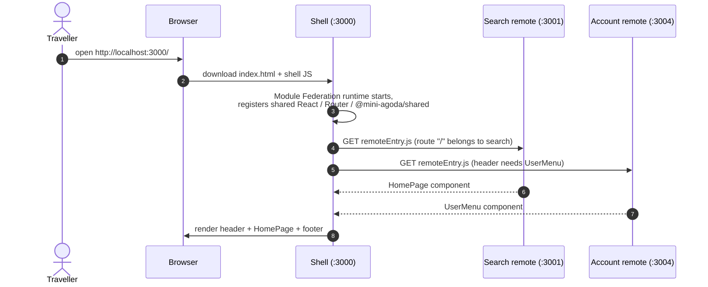
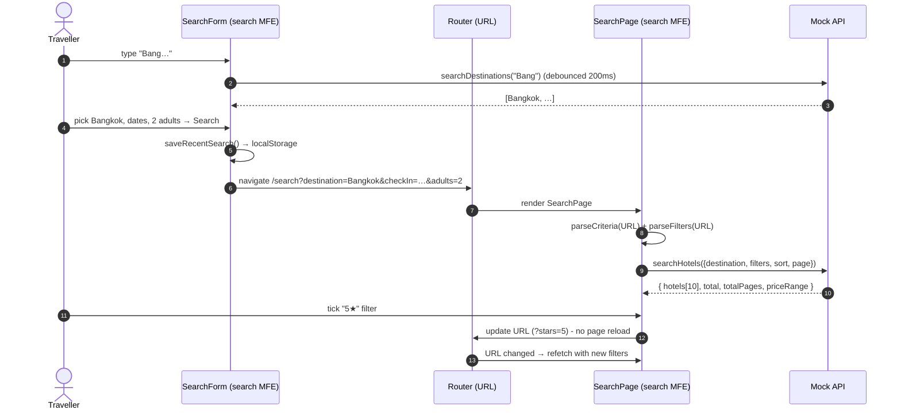
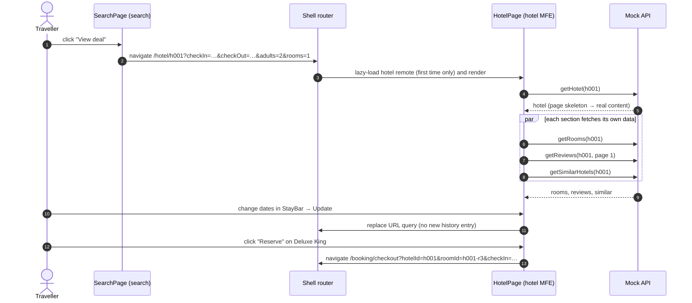
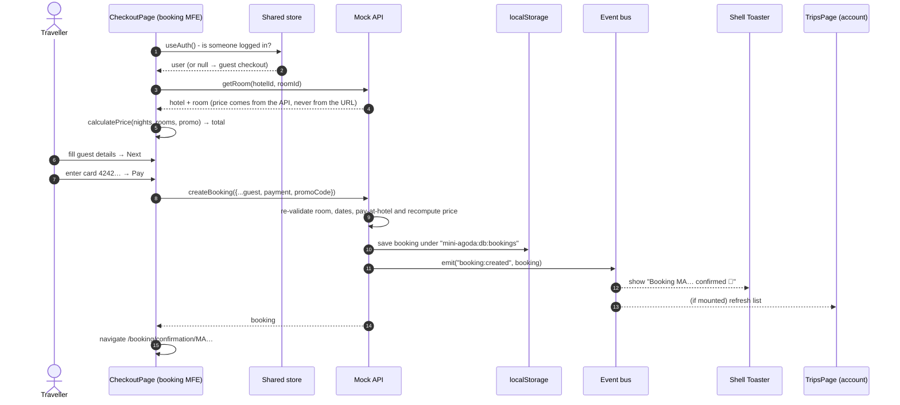
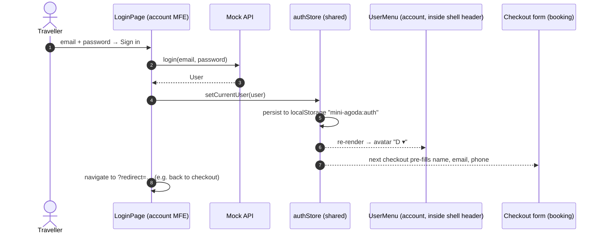
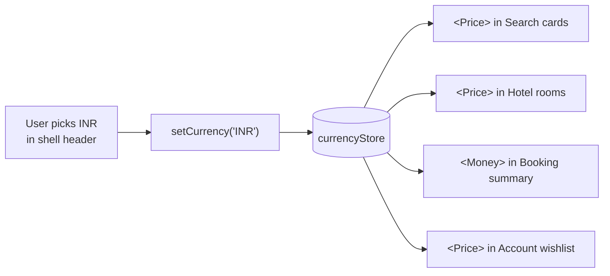
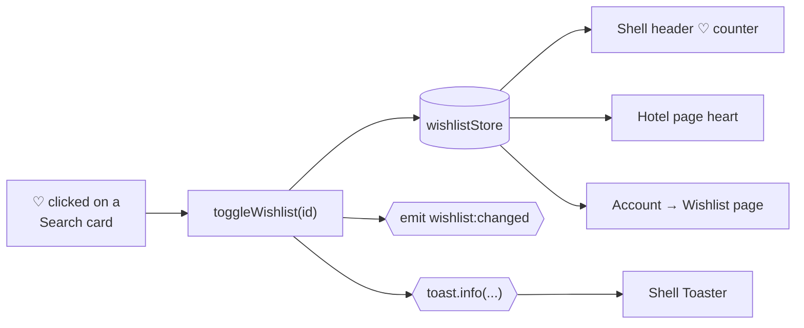
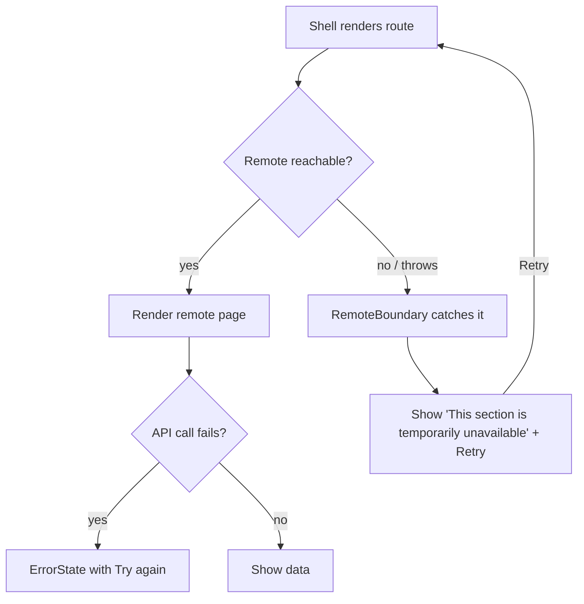

# Data Flow - Explained Simply

> **Goal of this document:** understand how data moves through Mini Agoda
> without needing to know Module Federation, React or Vite in depth.
> If you only read one doc, read this one.

---

## 1. The 30-second mental model

Think of Mini Agoda as a **shopping mall**:

| Mall                         | Mini Agoda                                                       |
| ---------------------------- | ---------------------------------------------------------------- |
| The mall building & corridors | **Shell** - header, footer, routing (decides which shop you're in) |
| Individual shops              | **Micro frontends** - Search, Hotel, Booking, Account            |
| Shop's own staff              | Each MFE's own React components & CSS                            |
| Mall-wide PA announcements    | **Event bus** (`eventBus.emit(...)`)                             |
| Shared notice board           | **Shared store** (logged-in user, currency, wishlist)            |
| Ticket you carry between shops | **URL query parameters** (`?checkIn=...&adults=2`)              |
| The warehouse                 | **Mock API** (`api.*`) backed by `localStorage`                  |

Each shop (MFE) is built and deployed separately, but when you walk through the
mall it feels like one building. Shops **never walk into each other's back
rooms** (no direct imports between MFEs) - they talk only through the ticket
(URL), the notice board (store) or announcements (events).

---

## 2. The big picture

- **Every arrow into `Shared` is a normal function call.** Because the shared
  package is loaded exactly once (a Module Federation *singleton*), all MFEs see
  the same store, the same event bus and the same API.
- **The API is the only thing that touches persistent data.** Today it is mock
  data + `localStorage`; tomorrow it can be `fetch()` calls to a real backend
  without changing any MFE.

---

## 3. Three ways data moves (and when to use each)

| Channel          | Use it for                                         | Example                                          | Survives reload?          |
| ---------------- | -------------------------------------------------- | ------------------------------------------------ | ------------------------- |
| **URL params**   | "What page & what am I looking at?"                | dates, guests, filters, hotelId, roomId          | ✅ yes (and shareable)     |
| **Shared store** | Long-lived, app-wide state many MFEs read          | logged-in user, currency, wishlist               | ✅ yes (localStorage)      |
| **Event bus**    | "Something just happened" notifications            | booking created, toast message, user logged in   | ❌ no (fire-and-forget)    |

Rule of thumb: **if you can put it in the URL, put it in the URL.**

---

## 4. Journey walkthroughs

Each walkthrough follows one user action from click to screen.

### 4.1 Opening the site

**In plain words:** the shell loads first and draws the frame. It then asks
the search MFE for its home page and the account MFE for the user menu in the
header. Only the code for the current page is downloaded. The hotel and booking
code isn't fetched until you need it.

### 4.2 Searching for hotels

**In plain words:** the search form doesn't store results anywhere. It just
writes your choices into the URL. The results page reads the URL, asks the API,
and shows what comes back. Changing a filter changes the URL again, so the
page refreshes its results. Because of this, you can copy the link, reload, or
press Back and you'll still see the same results.

### 4.3 Viewing a hotel and picking a room

**In plain words:** the search MFE passes your dates and guests to the hotel MFE
in the link. The hotel MFE loads the hotel's own data from the API. When you
click *Reserve*, it builds another link for the booking MFE. **No MFE hands a
JavaScript object to another one.** Only URLs cross the boundary.

### 4.4 Checking out (the most important flow)

**In plain words:**

1. The URL says *which* room and dates you want, but **the price always comes
   from the API**, so nobody can edit the price by changing the URL.
2. When you pay, the API checks everything again, saves the booking and
   announces *"a booking was created"*.
3. The shell hears the announcement and shows a toast. The account MFE hears it
   too and refreshes "My trips". The booking MFE doesn't need to know that
   either of them exists.

### 4.5 Logging in

**In plain words:** logging in writes the user to the shared store. Every
component that reads the store (the header menu, the checkout form, the trips
page) updates automatically. Nobody has to send them a message.

### 4.6 Switching currency

All prices are stored in **USD**. The `<Price>` / `<Money>` components from the
shared package read the selected currency and convert while rendering. One
store update re-renders prices in all four MFEs.

### 4.7 Saving to wishlist

---

## 5. Who owns which data?

| Data                        | Owner (writes)    | Readers                          | Lives in                              |
| --------------------------- | ----------------- | -------------------------------- | ------------------------------------- |
| Hotels, rooms, reviews      | Mock API          | Search, Hotel, Booking, Account  | In-memory (generated, deterministic)  |
| Search criteria & filters   | Search MFE        | Search, Hotel, Booking (via URL) | URL query string                      |
| Recent searches             | Search MFE        | Search MFE                       | `localStorage: mini-agoda:search:recent` |
| Selected room & stay        | Hotel MFE         | Booking MFE                      | URL query string                      |
| Bookings                    | Mock API          | Booking, Account                 | `localStorage: mini-agoda:db:bookings` |
| Users (accounts)            | Mock API          | Account                          | `localStorage: mini-agoda:db:users`    |
| Current user (session)      | Account MFE       | Everyone                         | `authStore` → `mini-agoda:auth`        |
| Currency                    | Shell             | Everyone                         | `currencyStore` → `mini-agoda:currency` |
| Wishlist                    | Anyone (heart)    | Shell, Search, Hotel, Account    | `wishlistStore` → `mini-agoda:wishlist` |
| Toast messages              | Anyone            | Shell                            | Event only (not stored)               |

**Golden rule:** each piece of data has exactly **one writer**. Many MFEs
can read it.

---

## 6. What happens when something breaks?

- If the **booking server is down**, search and hotel pages keep working. Only
  `/booking/*` shows a friendly error card with a Retry button.
- If the **account server is down**, the header shows a plain "Sign in" link
  instead of the user menu, so the page still renders.
- Open the 🧩 button (bottom-left) or press **Ctrl+Shift+M** to see which
  remotes are loaded, loading or failed. You can also outline each MFE on the page.

---

## 7. Glossary

| Term                  | Meaning                                                                        |
| --------------------- | ------------------------------------------------------------------------------ |
| **Micro frontend (MFE)** | A slice of the UI owned, built and deployed by one team.                  |
| **Shell / host**      | The app the browser opens first. It composes the MFEs.                         |
| **Remote**            | An MFE that *exposes* components for the shell to load at runtime.            |
| **remoteEntry.js**    | The small "menu" file each remote publishes, listing what it exposes.          |
| **Module Federation** | The technology that lets one JS app load code from another at runtime.         |
| **Singleton (shared)** | A library loaded once and reused by every MFE (React, Router, our shared pkg). |
| **Event bus**         | A publish/subscribe channel on `window` for "something happened" messages.     |
| **Store**             | A small global state container. Changing it re-renders every subscriber.      |
