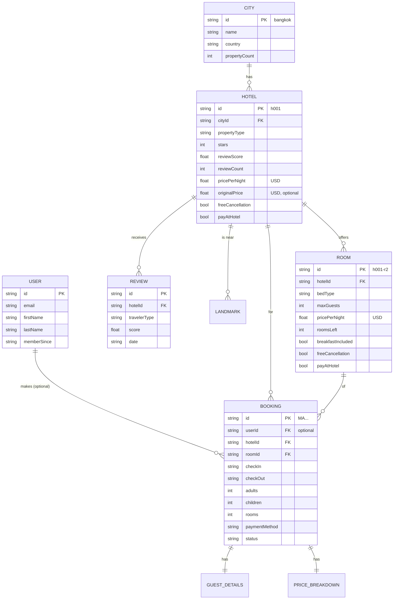

# Data Model & Mock API

All types live in [`packages/shared/src/types.ts`](../packages/shared/src/types.ts).
All data access goes through [`packages/shared/src/api/index.ts`](../packages/shared/src/api/index.ts).

## 1. Entities



## 2. Mock data

| Data      | Size              | Source                                                         |
| --------- | ----------------- | -------------------------------------------------------------- |
| Cities    | 8                 | hand-written (`data/cities.ts`)                                |
| Hotels    | 47                | hand-written names + **seeded generator** (`data/hotels.ts`)   |
| Rooms     | 3-5 per hotel     | generated on demand from templates                             |
| Reviews   | 14-28 per hotel   | generated on demand                                            |
| Images    | Unsplash URLs     | `<SmartImage>` falls back to picsum.photos, then a gradient    |

The generator uses a seeded PRNG (`mulberry32` seeded by a hash of the hotel id),
so **every reload and every MFE sees identical data**, which makes bug reports
reproducible.

## 3. "Database" (localStorage)

| Key                          | Contents                         | Written by              |
| ---------------------------- | -------------------------------- | ----------------------- |
| `mini-agoda:db:users`        | registered users (+ demo user)   | `api.signup`, `api.updateProfile` |
| `mini-agoda:db:bookings`     | all bookings                     | `api.createBooking`, `api.cancelBooking` |
| `mini-agoda:auth`            | `{ user }` current session       | `setCurrentUser`        |
| `mini-agoda:currency`        | `{ currency }`                   | `setCurrency`           |
| `mini-agoda:wishlist`        | `{ hotelIds }`                   | `toggleWishlist`        |
| `mini-agoda:search:recent`   | last 4 searches                  | search MFE              |

Reset everything: DevTools → Application → Local Storage → clear the `mini-agoda:*` keys.

## 4. API reference

Every function is `async` and adds 250-650 ms of latency (configurable via
`LATENCY_MS`). Errors are thrown as `ApiError(message, status)`.

| Function | Returns | Notes |
| --- | --- | --- |
| `getCities()` | `City[]` | |
| `searchDestinations(query)` | `Destination[]` | cities + up to 5 hotel-name matches; popular cities when empty |
| `getDeals(limit = 8)` | `Hotel[]` | sorted by discount % |
| `searchHotels(request)` | `SearchResponse` | destination match → filters → sort → paginate; also returns `priceRange` |
| `getHotel(id)` | `Hotel` | 404 if unknown |
| `getHotelsByIds(ids)` | `Hotel[]` | used by wishlist |
| `getSimilarHotels(id, limit)` | `Hotel[]` | same city, closest price |
| `getRooms(hotelId)` | `Room[]` | |
| `getRoom(hotelId, roomId)` | `{ hotel, room }` | used by checkout |
| `getReviews(hotelId, { page, pageSize, travelerType })` | `ReviewsResponse` | includes category summary |
| `login(email, password)` | `User` | 401 on bad credentials |
| `signup({ firstName, lastName, email, password })` | `User` | 409 if email exists |
| `updateProfile(userId, patch)` | `User` | |
| `createBooking(request)` | `Booking` | validates room, dates, pay-at-hotel; **recomputes price**; emits `booking:created` |
| `getBooking(id)` / `getBookings(userId)` | `Booking` / `Booking[]` | |
| `cancelBooking(id)` | `Booking` | only refundable bookings before check-in; emits `booking:cancelled` |

### Pricing formula

```text
roomTotal     = pricePerNight × nights × rooms
discount      = roomTotal × promo% (capped by promo.maxDiscount)
taxesAndFees  = (roomTotal − discount) × 15%      // 10% tax + 5% service fee
total         = roomTotal − discount + taxesAndFees
```

## 5. Swapping in a real backend

Keep the function signatures and replace the bodies:

```ts
export async function searchHotels(request: SearchRequest): Promise<SearchResponse> {
  const res = await fetch(`${API_URL}/hotels/search?${new URLSearchParams(serialize(request))}`);
  if (!res.ok) throw new ApiError(await res.text(), res.status);
  return res.json();
}
```

No MFE changes are needed, because MFEs only depend on the function signatures and
`types.ts`.
