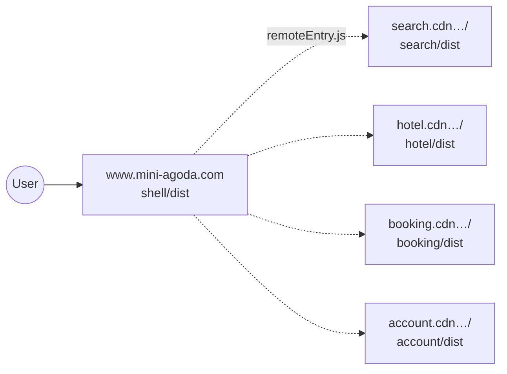
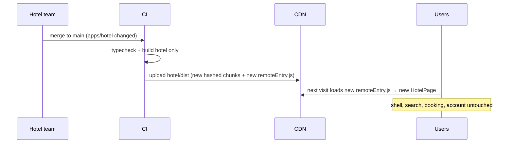

# Deployment

Each app builds to a **static folder** (`apps/<name>/dist`) and can be hosted
anywhere that serves static files: S3 + CloudFront, Netlify, Vercel, Nginx, etc.

## 1. Topology



Each remote can live on its own origin (or on its own path of one CDN).

## 2. Build with production URLs

Remote locations are baked into the shell, and each remote's absolute `base`,
at build time from environment variables (see `packages/vite-config/remotes.js`):

```bash
SEARCH_URL=https://search.cdn.mini-agoda.com \
HOTEL_URL=https://hotel.cdn.mini-agoda.com \
BOOKING_URL=https://booking.cdn.mini-agoda.com \
ACCOUNT_URL=https://account.cdn.mini-agoda.com \
npm run build
```

> Build each remote with **its own** URL variable set, because the remote uses it
> as its asset `base`. Build the shell with **all** of them set.

## 3. Hosting requirements

| Requirement | Why |
| --- | --- |
| **CORS** `Access-Control-Allow-Origin: <shell origin>` on remotes | The shell loads remote ES modules cross-origin. |
| **SPA fallback** (`/* → /index.html`) on the shell | Deep links like `/hotel/h001` must load the app. |
| `remoteEntry.js` → `Cache-Control: no-cache` | So the shell always discovers the latest remote build. |
| Hashed assets (`assets/*-[hash].js`) → `Cache-Control: max-age=31536000, immutable` | Safe long-term caching. |
| HTTPS everywhere | Mixed content would block remote modules. |

## 4. Independent releases



- **Deploy remotes before** the shell when a release needs both (backwards-compatible exposes first).
- **Rollback** = re-upload the previous `dist` (or repoint `remoteEntry.js`).
- **Breaking changes to `@mini-agoda/shared`** need a coordinated release. Bump its version and set `requiredVersion` so mismatches show up as warnings.

## 5. CI suggestion

```yaml
# .github/workflows/ci.yml (sketch)
jobs:
  changed:
    # detect which apps/* or packages/* changed (e.g. dorny/paths-filter)
  build:
    strategy:
      matrix: { app: [shell, search, hotel, booking, account] }
    steps:
      - run: npm ci
      - run: npm run typecheck -w @mini-agoda/${{ matrix.app }}
      - run: npm run build -w @mini-agoda/${{ matrix.app }}
      - run: aws s3 sync apps/${{ matrix.app }}/dist s3://mini-agoda-${{ matrix.app }}
```

A change in `packages/shared` should rebuild **all** apps.

## 6. Local production check

```bash
npm start     # build + preview on ports 3000-3004
```
