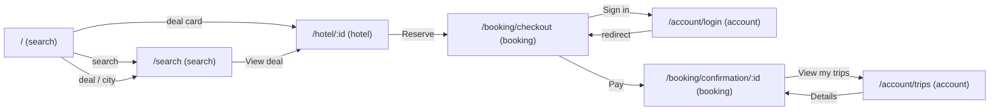

# Micro Frontend Catalogue & Contracts

For each micro frontend: what it owns, what it exposes, the URLs it accepts and
the events it sends or receives. **Treat this file as the API documentation
between teams.**

---

## Shell (host) · `apps/shell` · :3000 · *Platform team*

| | |
| --- | --- |
| **Owns** | `<BrowserRouter>`, top-level routes, header, footer, 404, toasts, currency selector, MFE inspector, scroll restoration |
| **Exposes** | nothing |
| **Consumes** | `search/HomePage`, `search/SearchPage`, `hotel/HotelPage`, `booking/BookingApp`, `account/AccountApp`, `account/UserMenu` |
| **Writes** | `currencyStore` |
| **Listens** | `ui:toast`, `auth:changed`, `booking:created` → shows toasts |

---

## Search · `apps/search` · :3001 · *Discovery team*

| | |
| --- | --- |
| **Owns** | Home page, search form (autocomplete, dates, guests), results, filters, sort, pagination, recent searches |
| **Exposes** | `./HomePage` → mounted at `/` · `./SearchPage` → mounted at `/search` |
| **Reads** | URL, `currencyStore`, `wishlistStore` |
| **Emits** | `search:submitted { criteria }` |
| **Navigates to** | `/search?…`, `/hotel/:id?…` |
| **Local storage** | `mini-agoda:search:recent` |

## Hotel · `apps/hotel` · :3002 · *Property team*

| | |
| --- | --- |
| **Owns** | Property page: gallery + lightbox, overview, stay editor, rooms & rates, facilities, reviews, location, policies, similar hotels |
| **Exposes** | `./HotelPage` → mounted at `/hotel/:hotelId` |
| **Reads** | `:hotelId` param, stay params, `currencyStore`, `wishlistStore` |
| **Navigates to** | `/booking/checkout?…`, `/search?destination=<city>` |

## Booking · `apps/booking` · :3003 · *Checkout team*

| | |
| --- | --- |
| **Owns** | Checkout (guest details → payment), promo codes, price breakdown, price-hold timer, confirmation |
| **Exposes** | `./BookingApp` → mounted at `/booking/*` (routes: `checkout`, `confirmation/:bookingId`) |
| **Reads** | URL, `authStore` (pre-fill + link booking to user), `currencyStore` |
| **Emits** | `booking:created` (via `api.createBooking`), `ui:toast` |
| **Navigates to** | `/booking/confirmation/:id`, `/account/login?redirect=…`, `/account/trips` |

## Account · `apps/account` · :3004 · *Identity team*

| | |
| --- | --- |
| **Owns** | Sign in / sign up, profile, my trips (+ cancellation), wishlist page, header user menu |
| **Exposes** | `./AccountApp` → `/account/*` (routes: `login`, `signup`, `trips`, `wishlist`, `profile`) · `./UserMenu` → shell header fragment |
| **Writes** | `authStore` (`setCurrentUser`) |
| **Emits** | `auth:changed`, `booking:cancelled` (via API), `ui:toast` |
| **Listens** | `booking:created`, `booking:cancelled` → refresh trips |
| **Guards** | `trips` and `profile` redirect to `login?redirect=…` when signed out |

---

## URL contracts

These query parameters are **public API**. Parsing/building lives in
[`packages/shared/src/utils/search-params.ts`](../packages/shared/src/utils/search-params.ts)
(`parseCriteria`, `parseFilters`, `hotelUrl`, `checkoutUrl`). Always use those
helpers instead of building strings by hand.

### Stay criteria (used by `/search`, `/hotel/:id`, `/booking/checkout`)

| Param         | Type          | Default            | Validation                              |
| ------------- | ------------- | ------------------ | --------------------------------------- |
| `destination` | string        | `''` (anywhere)    | free text, matched on city/country/name |
| `checkIn`     | `YYYY-MM-DD`  | today + 7          | not in the past                         |
| `checkOut`    | `YYYY-MM-DD`  | checkIn + 2        | ≥ checkIn + 1                           |
| `adults`      | int           | 2                  | rooms … 16                              |
| `children`    | int           | 0                  | 0 … 10                                  |
| `rooms`       | int           | 1                  | 1 … 8                                   |

### Search filters (`/search` only)

| Param              | Example                 | Meaning                       |
| ------------------ | ----------------------- | ----------------------------- |
| `minPrice` / `maxPrice` | `maxPrice=150`     | USD per night                 |
| `stars`            | `stars=4,5`             | any of these star ratings     |
| `minScore`         | `minScore=8`            | review score ≥ value          |
| `types`            | `types=Hotel,Resort`    | property types                |
| `amenities`        | `amenities=Spa,Parking` | must have **all**             |
| `freeCancellation` | `true`                  | only refundable properties    |
| `sort`             | `price_asc`             | `recommended` (default), `price_asc`, `price_desc`, `rating`, `stars`, `distance` |
| `page`             | `2`                     | 1-based, 10 per page          |

### Checkout (`/booking/checkout`)

Stay criteria **plus** `hotelId` and `roomId` (both required). The price is
**never** passed in the URL.

---

## Event contracts

Defined (and type-checked) in [`packages/shared/src/events.ts`](../packages/shared/src/events.ts).

| Event               | Payload                    | Emitted by                  | Consumed by           |
| ------------------- | -------------------------- | --------------------------- | --------------------- |
| `auth:changed`      | `{ user \| null }`         | `setCurrentUser()`          | Shell (toast)         |
| `currency:changed`  | `{ currency }`             | `setCurrency()`             | (available)           |
| `wishlist:changed`  | `{ hotelIds }`             | `toggleWishlist()`          | (available)           |
| `search:submitted`  | `{ criteria }`             | Search form                 | (analytics hook)      |
| `booking:created`   | `{ booking }`              | `api.createBooking()`       | Shell toast, Account trips |
| `booking:cancelled` | `{ bookingId }`            | `api.cancelBooking()`       | Account trips         |
| `ui:toast`          | `{ message, type? }`       | anyone via `toast.*()`      | Shell Toaster         |

## Exposed-module typing

The shell declares the shape of each exposed module in
[`apps/shell/src/remotes.d.ts`](../apps/shell/src/remotes.d.ts). When a remote
adds or renames an expose, update that file in the same PR.
