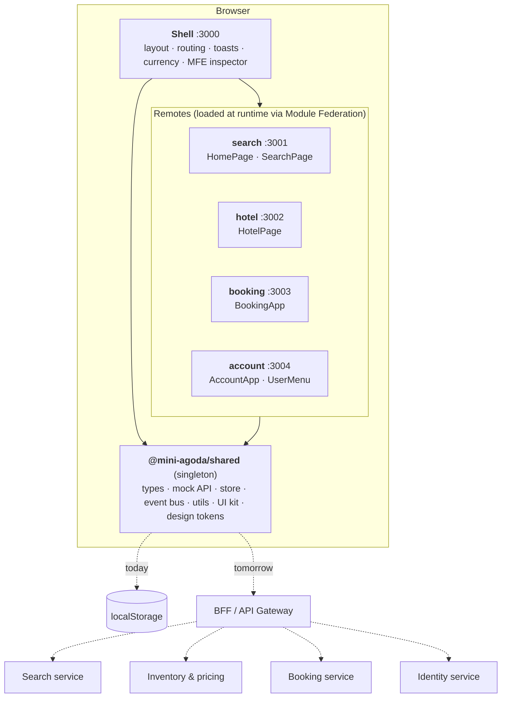
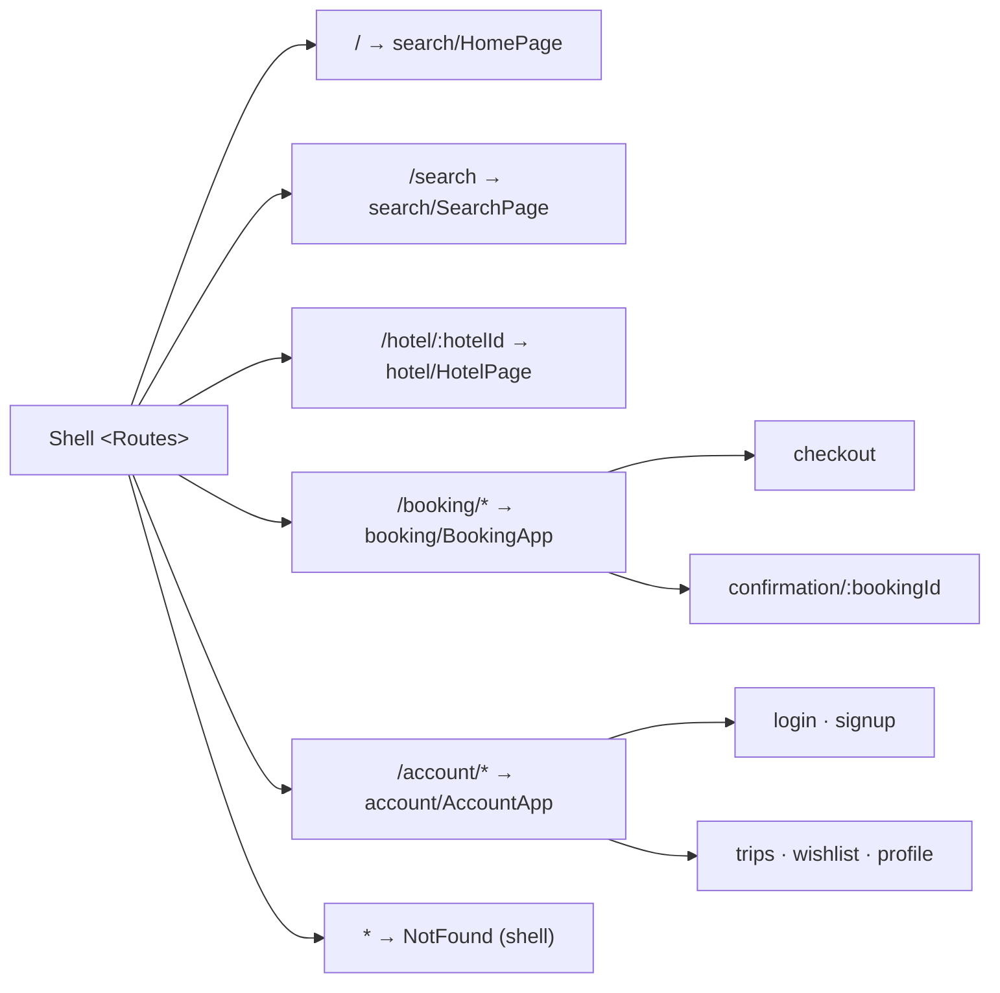
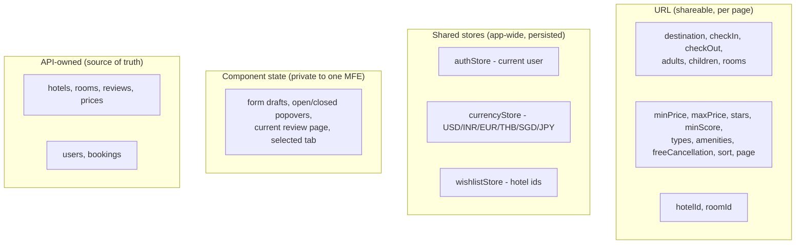
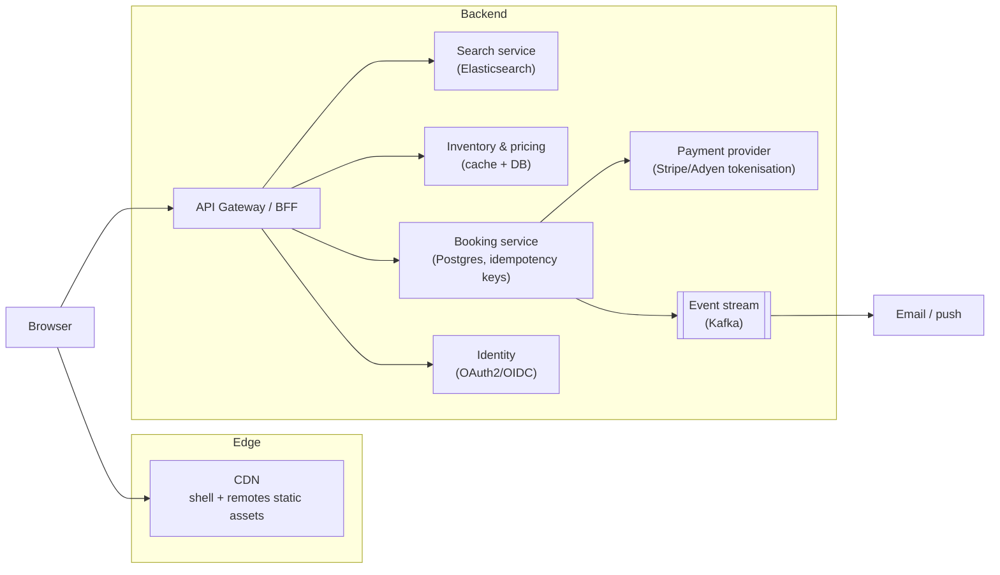

# System Design - Mini Agoda

This document describes **what** we are building, **why** it is shaped this
way, and **how it would grow** into a production system. For a plain-English
walkthrough of how data moves, see [DATA_FLOW.md](./DATA_FLOW.md).

---

## 1. Problem statement

Build a hotel booking website (in the style of Agoda/Booking.com) where
several independent teams can each own a part of the customer journey and
ship it **independently**, while customers experience **one seamless site**.

---

## 2. Requirements

### 2.1 Functional

| #   | Capability                      | Owned by    | Status |
| --- | ------------------------------- | ----------- | ------ |
| F1  | Search destinations with autocomplete (cities + hotels) | Search  | ✅ |
| F2  | Pick dates, adults, children, rooms                     | Search  | ✅ |
| F3  | Results list with filters (price, stars, score, type, facilities, free cancellation), sorting and pagination | Search | ✅ |
| F4  | Home page: popular destinations, top deals, recent searches | Search | ✅ |
| F5  | Hotel details: gallery, overview, facilities, location, policies, similar hotels | Hotel | ✅ |
| F6  | Room & rate selection with capacity/availability checks  | Hotel   | ✅ |
| F7  | Guest reviews with score breakdown, traveller-type filter, pagination | Hotel | ✅ |
| F8  | Checkout: guest details, payment (card / pay at hotel), promo codes, price breakdown | Booking | ✅ |
| F9  | Booking confirmation page                                 | Booking | ✅ |
| F10 | Sign in / sign up (mock), profile editing                 | Account | ✅ |
| F11 | My trips (upcoming / past / cancelled) with cancellation  | Account | ✅ |
| F12 | Wishlist (save hotels from anywhere)                      | Account + shared | ✅ |
| F13 | Multi-currency display                                    | Shell + shared   | ✅ |
| F14 | Global notifications (toasts)                             | Shell            | ✅ |

### 2.2 Non-functional

| Concern                 | Target / approach                                                                 |
| ----------------------- | --------------------------------------------------------------------------------- |
| **Independent delivery** | Each MFE builds & deploys alone; shell picks up new remote code with no rebuild.  |
| **Fault isolation**     | A failing remote degrades only its own area (error boundary + retry).             |
| **Performance**         | Route-level lazy loading; React/Router loaded once; only the current page's code downloads. |
| **Consistency**         | Shared design tokens + UI primitives; one copy of React.                          |
| **Shareable state**     | Search/hotel/checkout state lives in the URL → deep links & reloads work.         |
| **Security (demo level)** | Price always recomputed by the API; safe redirects; no card data stored (last 4 only). |
| **Accessibility**       | Semantic HTML, labelled inputs, ARIA on combobox, dialogs, tabs, toasts.          |
| **Developer experience** | Each MFE runs standalone with HMR; one command to run everything.                |

### 2.3 Out of scope (for now)

Real payments, real authentication (JWT/OAuth), server-side rendering, i18n of
copy, real availability/inventory, maps SDK, analytics.

---

## 3. High-level architecture

### 3.1 Components

| Component            | Responsibility                                                           | Talks to                         |
| -------------------- | ------------------------------------------------------------------------ | -------------------------------- |
| **Shell (host)**     | Owns `<BrowserRouter>`, top-level routes, header/footer, toaster, error boundaries, currency picker. Contains **no business pages**. | All remotes, shared |
| **Search MFE**       | Discovery: home page, search form, results, filters, sort, pagination.  | Shared API; links to Hotel via URL |
| **Hotel MFE**        | Property details, rooms & rates, reviews, location, policies.           | Shared API; links to Booking via URL |
| **Booking MFE**      | Checkout steps, validation, payment, promo codes, confirmation.         | Shared API + auth store; emits `booking:created` |
| **Account MFE**      | Auth pages, profile, trips, wishlist, and the header **UserMenu fragment**. | Shared API + stores; listens to booking events |
| **Shared package**   | The *contract*: domain types, API client, stores, event bus, helpers, UI primitives, CSS tokens. | Everyone |
| **Vite config package** | One factory that gives every app identical federation, CSS-module scoping and dev-server settings. | Build time only |

---

## 4. Key design decisions

| Decision | Choice | Why | ADR |
| --- | --- | --- | --- |
| How to compose MFEs | **Runtime composition with Module Federation** (`@module-federation/vite`) | Independent deploys without rebuilding the shell; shared singletons; same React tree (no iframes). | [0001](./adr/0001-module-federation.md) |
| Build tool | **Vite 8** | Fast dev server & HMR; official MF plugin supports dev-mode remotes. | [0002](./adr/0002-vite.md) |
| Split strategy | **Vertical, by user journey** (discover → view → book → manage) | Each team owns a business capability end-to-end; minimal cross-team coupling. | [0003](./adr/0003-vertical-split.md) |
| Cross-MFE communication | **URL > shared store > event bus**, never direct imports | Loose coupling, testable, deep-linkable. | [0004](./adr/0004-communication.md) |
| Styling | **CSS Modules prefixed with the MFE name** + global tokens | Zero style leakage between teams; consistent look. | [0005](./adr/0005-styling.md) |
| Data | **Mock API with latency** in shared package, `localStorage` as DB | Real async behaviour now; swap to `fetch` later without touching MFEs. | [0006](./adr/0006-mock-api.md) |

---

## 5. Routing design

The shell owns the **first path segment**; each MFE owns everything below it.

One router instance (shared singleton `react-router-dom`) means `<Link>`,
`useNavigate` and the browser Back button work seamlessly across MFEs.

---

## 6. State design

**Decision rule:** keep state as *local* as possible. Promote it to the URL if it
should survive a reload or be shareable. Promote it to a shared store only if
**several MFEs** need it **across pages**.

---

## 7. Pricing & booking integrity

- All prices are stored and calculated in **USD**. Currency conversion happens
  only when rendering (`formatPrice`).
- `calculatePrice(pricePerNight, nights, rooms, promoCode)` →
  `roomTotal − discount + 15% taxes & fees`.
- The checkout **never trusts the URL for the price**. It only reads
  `hotelId`/`roomId`/dates from the URL and fetches the price from the API.
  `createBooking` recomputes it again on the "server".
- Promo codes: `AGODA10` (10%), `MINI20` (20%, max $100), `WELCOME5` (5%).

---

## 8. Failure handling

| Failure                         | Behaviour                                                             |
| ------------------------------- | --------------------------------------------------------------------- |
| Remote JS can't be fetched      | `RemoteBoundary` shows a card with **Retry**; rest of site keeps working. |
| Remote throws while rendering   | Same boundary catches it; error logged with the remote id.            |
| Header fragment fails           | Falls back to a plain "Sign in" link.                                  |
| API error                       | Each page renders `ErrorState` with *Try again* (`useAsync().reload`). |
| Hotel / booking not found       | Dedicated empty states with a next action.                            |
| Stale responses (fast typing / filter clicks) | `useAsync` ignores responses from superseded requests.      |
| `localStorage` unavailable      | `storage` helper swallows errors - state just doesn't persist.        |

---

## 9. Performance

- **Lazy remotes:** each route's remote is fetched only on first visit.
- **Shared singletons:** React, React DOM, React Router and the shared package
  are downloaded **once**, no matter how many MFEs are on the page.
- **Skeletons** for perceived performance on every data-driven view.
- **Images** are lazy-loaded with automatic fallback (`<SmartImage>`).
- **Debounced** destination autocomplete (200 ms).
- **Filter slider** commits on release, not on every pixel.

---

## 10. Evolving to production

| Step | Change | Impact on MFEs |
| ---- | ------ | -------------- |
| 1 | Replace `packages/shared/src/api` internals with `fetch` to a BFF | **None** - same function signatures. |
| 2 | Real auth: store tokens in httpOnly cookies, `authStore` holds profile only | Account MFE only. |
| 3 | Payment: card fields in a provider iframe (PCI scope reduction) | Booking MFE only. |
| 4 | Runtime remote discovery via `mf-manifest.json` / remote registry | Shell config only. |
| 5 | Version the shared package (semver) & enforce `requiredVersion` | Build config. |
| 6 | Add SSR for SEO on search & hotel pages | Search, Hotel, Shell. |
| 7 | Observability: tag errors & web-vitals with the MFE name | `RemoteBoundary` + shared. |

---

## 11. Trade-offs we accepted

| Benefit | Cost |
| ------- | ---- |
| Teams deploy independently | More moving parts (5 servers in dev, 5 deploy targets). |
| Fault isolation per remote | Need error boundaries & fallbacks everywhere. |
| One shared React tree (no iframes) | Shared deps must stay version-compatible (singletons). |
| Shared package gives consistency | It is a coupling point - changes need care and versioning. |
| URL as contract is simple & robust | URL params must be documented and backward compatible. |
